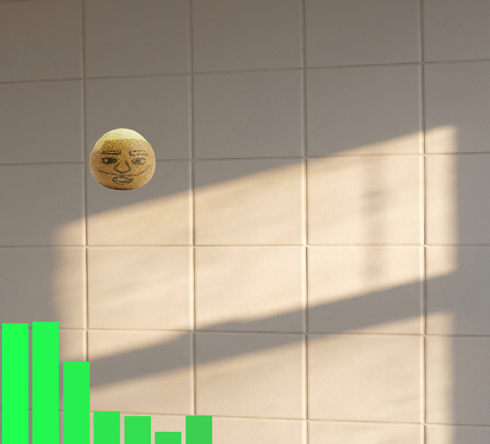

# Graduation / Blonde Audio Visualizer

An audio visualizer inspired by the albums *Graduation* (Kanye West) and *Blonde* (Frank Ocean). It listens to any sound, from your microphone or from an audio file, and turns it into moving bars or a waveform while a character jumps to the loudness.



**Demo video:** https://youtu.be/s5xd160k-S0

## Try it (no coding needed)

1. Go to the [latest release](https://github.com/ahmadallaf53-dot/Graduation-Blonde-Themed-Audio-Visualizer/releases/latest).
2. Download `GraduationBlondeVisualizer-windows.zip` and **unzip the whole folder**.
3. Double-click `Graduation Blonde Visualizer.exe`.

Windows may show a SmartScreen warning because the app is not signed. Click **More info → Run anyway**.

No music is included, so you bring your own: use your microphone or pick a song from your computer.

## Controls

| Where | Key | What it does |
|---|---|---|
| Start screen | `M` | Use the microphone |
| Start screen | `F` | Open an audio file (WAV, MP3, OGG, FLAC) |
| Style screen | `1` / `2` | Choose the theme (Graduation or Blonde) |
| Style screen | `H` | Back to the start screen |
| While playing | `W` | Switch between bars and waveform |
| While playing | `H` | Back to the start screen |

## What it reacts to

Everything you see comes from the sound itself, so it works with any song:

- **Bars:** 16 bars, one per frequency range. Louder frequencies make taller bars.
- **Waveform:** the raw sound wave drawn as a line (like an oscilloscope).
- **Character:** jumps higher the louder the sound is.

## How it works

- Audio is read in small chunks (1024 samples), either from the microphone with **PyAudio** or from a file with **soundfile**. For files, the position in the song is taken from the pygame mixer so the visuals match what you hear.
- **NumPy** runs an FFT (`np.fft.rfft`) on each chunk to split the sound into frequencies.
- The frequencies are grouped into 16 bands. The groups get wider towards the high end, so the bass gets more room.
- Bar heights and the waveform are smoothed by easing each value towards its target, which makes the motion look less jittery.
- The loudness (RMS) of each chunk controls how high the character jumps.
- **Pygame** draws everything.

## Run from source

You need Python 3 and a microphone (or an audio file).

```
git clone https://github.com/ahmadallaf53-dot/Graduation-Blonde-Themed-Audio-Visualizer.git
cd Graduation-Blonde-Themed-Audio-Visualizer
pip install -r requirements.txt
python v3.py
```

Keep the images (`bear.png`, `frankocean.png`, `background.jpg`, `blonded.jpg`) in the same folder as `v3.py`.

## Music and image credits

- **Music:** none is included. The demo video uses (add song, artist and license here).
- This is a non-commercial fan project. *Graduation* and *Blonde* and their artwork belong to their respective owners. The images are used for demonstration only and can be replaced with your own images using the same file names.
- The Frank Ocean image was made by me.

## License

The code is released under the [MIT License](LICENSE). The license does not cover the third-party artwork mentioned above.
