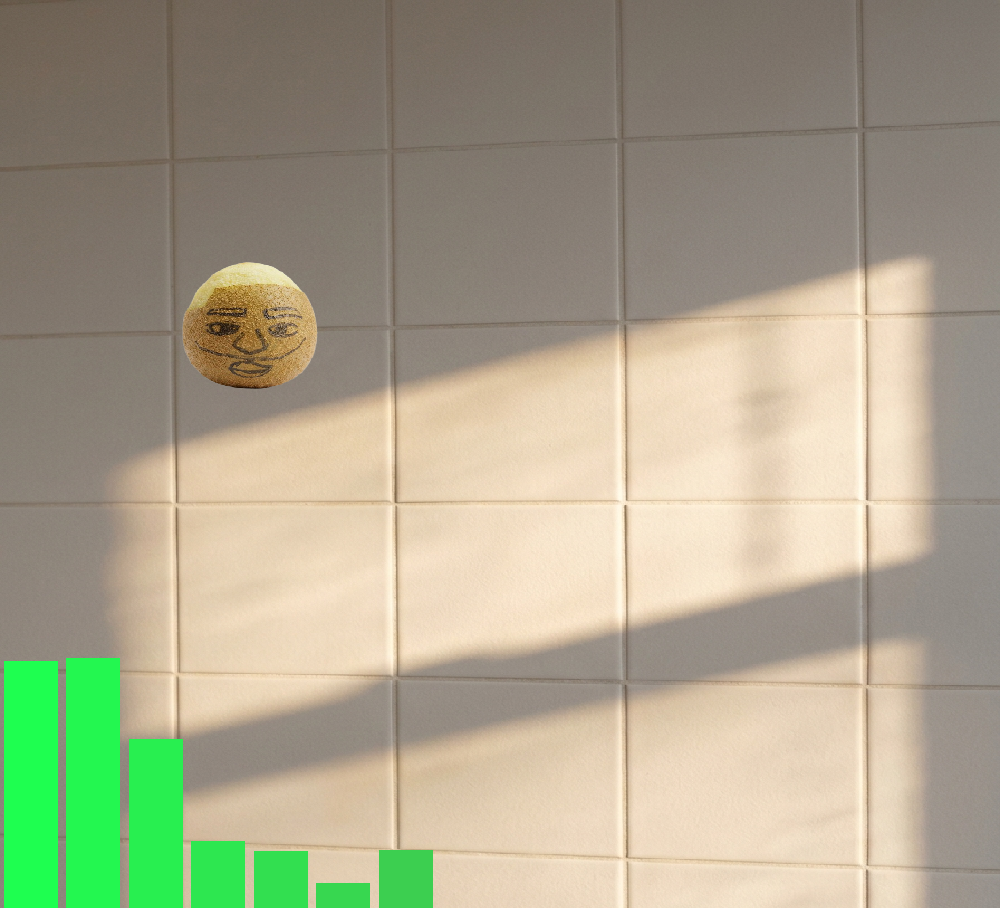

# Graduation / Blonde Audio Visualizer

I chose for my first project at cresent the Audio Visualizer Card. You can pick between a UI inspired by the album Blonded by Frank Ocean or a UI inspired by the album Graduation from Kanye West.
You can chose between bars, which show how loud each pich range is at the moment and a wave, which shows the actual shape of the sound over a certain moment, so that the louder the music gets, the higher and lower it swings up and down. 
There is additonaly a figure (depending on which UI you picked) which moves up and down with the volume.

**Demo video:** https://youtu.be/s5xd160k-S0

## Thats how you try it: 

1. Go to the my latest release or try this link (https://github.com/ahmadallaf53-dot/Graduation-Blonde-Themed-Audio-Visualizer/releases/latest).
2. Download `GraduationBlondeVisualizer-windows.zip` and unzip the whole folder.
3. Start the code and pick your audio source.
4. Pick a UI
5. Enjoy my excellent coding !

**Windows may show a SmartScreen warning because the app is not signed. Click More info → Run anyway**.
## What is new 
Circle Mode & Particles: Added a third visualizer mode (W to switch) that draws a frequency ring around the center with bass-reactive particles flying outwards.

Custom Themes: You can now choose your own custom themes and designs

Song Progress Bar: Added a progress bar at the bottom of the screen that appears while playing an audio file

Better Audio Reaction (Auto-Gain & Hanning Window): Added a Hanning window and automatic volume scaling so both quiet and loud songs look clean and responsive, with fast jump-up and smooth fall-down animations

Fullscreen & Quality of Life: Added F11 for fullscreen mode, automatic return to home when a song finishes, and better audio device checks so the app doesn't crash if no mic or output is connected

## What you see (explained in detail)

Everything you see on the screen comes from the sound, so it works with every song:
- **Circle:** The frequency ranges form a pulsing ring in the center, and if there is a strong bass particles will appear.
- **Bars:** There are 16 bars, and each bar is one frequency range. The louder a range is, the taller its bar gets.
- **Wave:** This is the real sound wave, drawn as a line (like on an oscilloscope).
- **Fiur:** The figure jumps higher when the music is louder.
  
## How it works

- The program reads the sound in small pieces (1024 samples). It gets them from the microphone with PyAudio or from a file with soundfile. For files, the program asks the pygame mixer where the song is right now, so the visuals match what you hear.
- Before splitting the sound, a Hann window (`np.hanning`) is applied to smooth the edges of each piece, and NumPy does an FFT (`np.fft.rfft`) to turn it into frequencies.
- The frequencies are put into 16 groups. The groups get bigger for the high sounds, so the bass has more space.
- Automatic gain scaling adjusts the sensitivity to the current volume, so both quiet and loud songs look good without clipping.
- The bars, the wave, and the circle do not jump directly to a new value—they react quickly when the sound gets louder and fall back smoothly when it gets quieter.
- In circle mode, the bass frequencies also spawn glowing particles that drift outward from the ring.
- The loudness (RMS) of each piece decides how high the character jumps.
- Pygame draws everything on the screen, including a progress bar at the bottom when playing an audio file[cite: 2, 3].
## Music and image credits

-  The demo video uses The Britons by Kevibn MAcLeod
- This is a non-commercial fan project. *Graduation* and *Blonde* and their artwork belong to their respective owners. The images are used for demonstration only and can be replaced with your own images using the same file names.
- The Frank Ocean image was made by me, I hope you like it :).

## License

The code is released under the [MIT License](LICENSE). The license does not cover the third-party artwork mentioned above.
